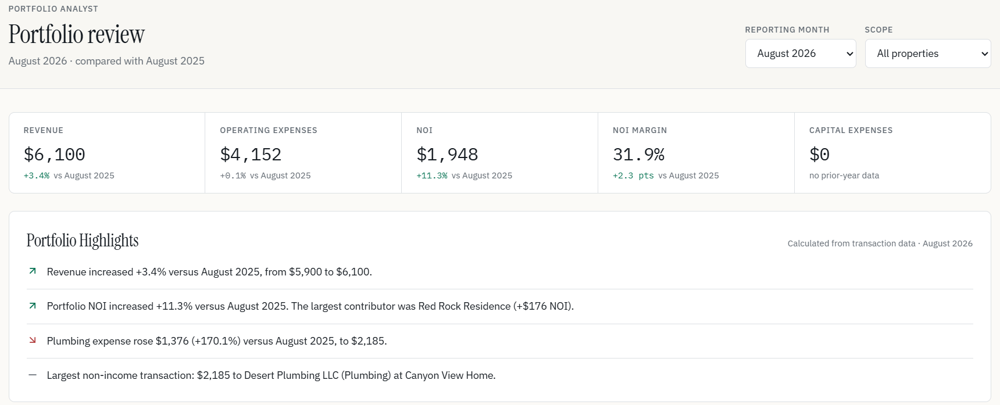
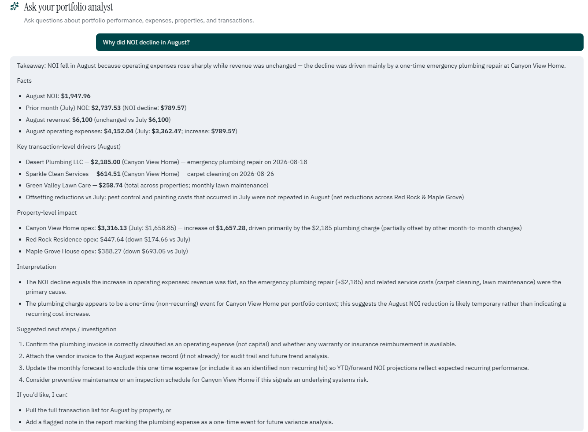
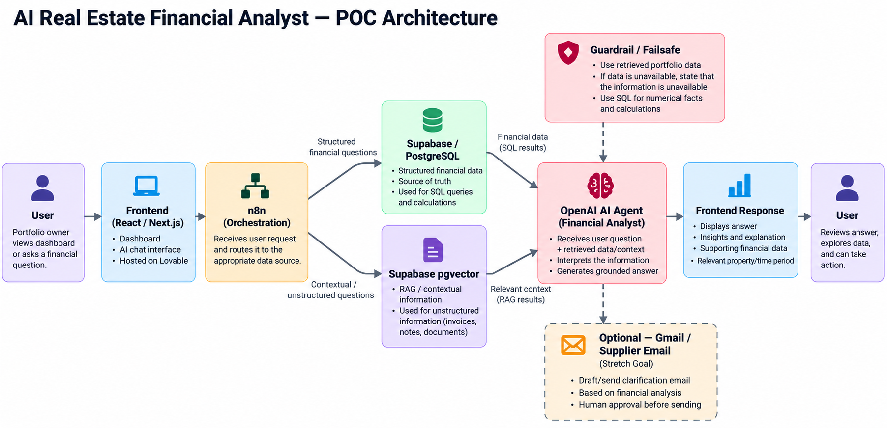

# AI Financial Analyst

An interactive financial dashboard with an embedded AI financial analyst that enables users to ask questions about their financial data and receive answers grounded in the underlying data.

## The Problem

Most financial reporting is static. Reports and slides are generated, reviewed, and distributed, but follow-up questions often require leaving the report, working in another application such as Excel, or asking an analyst to investigate and respond later.

## The Solution

An interactive financial dashboard that allows users to ask questions about their underlying financial data and receive responses grounded in that data.
Instead of treating the monthly business review as a static report, the AI Financial Analyst turns it into an interactive experience where users can investigate performance and ask follow-up questions.

## Demo

[Live Application]
[10-minute Demo Video]



## Product Documentation
Product Requirements Document:
https://app.notion.com/p/Real-Estate-Financial-Analyst-PRD-3e5e7060762480d99b65c1bcc7812d52

## How It Works

Architecture diagram



## Tech Stack

Lovable
Supabase / PostgreSQL
n8n
RAG
LLM
...

## Example Questions

"Why did NOI decline in August?"
"Which property had the largest increase in operating expenses?"
"How did August 2026 compare with August 2025?"
"What were our largest capital expenses?"
"How much did we spend on plumbing this year?"
"Show me the transactions behind the increase in maintenance expenses?"
...

## Product Decisions

### Why RAG? 
Financial questions require context from the user's underlying data. We use retrieval-augmented generation (RAG) to provide the AI with relevant financial context when generating responses.
### Why structured financial data? 
Financial data is stored in a structured database so that portfolio metrics and transactions can be consistently retrieved, analyzed, and traced back to the underlying data.
### How did we address hallucinations?
The AI is given explicit guidelines to ground responses in the available financial data and avoid generating unsupported information. Retrieval provides relevant context for the model, while the workflow limits the information available to the AI.
The goal is not to eliminate hallucinations entirely, but to constrain the system so that financial responses are grounded in the available data.

## Limitations

The current MVP is intentionally constrained to the financial data and questions supported by the underlying database and AI workflow. The system does not yet ingest new financial documents automatically, perform unrestricted SQL analysis, or access external market data.

## Next Iteration

Data ingestion
Replace the seed data used in the MVP with a secure data-ingestion workflow for real financial data. The prototype uses synthetic/seed data because actual portfolio data was not appropriate for a public demonstration.
Actions
Allow users to take actions from within the financial workflow, such as drafting an email to a supplier about an invoice or requesting clarification from a property manager.

Broader financial analysis
Expand beyond historical portfolio reporting to support scenario analysis, external benchmarks, and more complex financial questions.
...

## Development

Prefer working locally? You need Node.js and npm — [install with nvm](https://github.com/nvm-sh/nvm#installing-and-updating).

```sh
git clone <this-repository-url>
cd <repository-name>
npm i
npm run dev
```
